# Low-Level Design (LLD) in Java

A hands-on guide to object-oriented design, SOLID principles, and design patterns, using the Java examples in this repository. The README explains the **problem, class responsibilities, collaboration flow, and trade-offs** for each example.

> Diagrams are conceptual maps of the current examples. Follow the linked source files to verify exact method names and behavior.

## Contents

- [Repository map](#repository-map)
- [How to study an example](#how-to-study-an-example)
- [SOLID principles](#solid-principles)
- [Design patterns](#design-patterns)
- [Run examples](#run-examples)
- [Interview practice](#interview-practice)

## Repository map

| Topic | Source folder |
|---|---|
| SOLID principles | `src/solid/` |
| Abstract Factory | `src/absFactory/` |
| Adapter | `src/adapter/` |
| Builder | `src/builder/` |
| Chain of Responsibility | `src/chainOfResponsibility/` |
| Decorator | `src/decorator/` |
| Factory | `src/factory/` |
| Observer | `src/observer/` |
| Prototype | `src/prototype/` |
| Proxy | `src/proxy/` |
| Singleton | `src/singleton/` |
| Strategy | `src/strategy/` |

## How to study an example

1. Open the folder's `Main.java` and identify the objects being created.
2. Follow the calls from the entry point into each collaborator.
3. Read the interfaces/abstract classes first, then the implementations.
4. Change one behavior (for example, add a payment method) and note which classes must change.
5. Explain the design aloud: **problem → roles → collaboration → benefit → trade-off**.

## SOLID principles

### 1. Single Responsibility Principle (SRP)

**Code:** [src/solid/srp](src/solid/srp)

The example separates order operations, payment operations, email delivery, and invoice work into `OrderService`, `PaymentService`, `EmailService`, and `InvoiceService`. The entry point creates each service and calls its related operations.

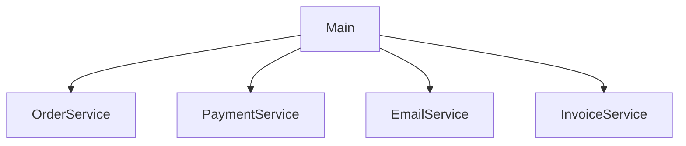

**Read it:** Start in `Main.java`, then inspect each service. The separation means an invoice-format change need not be made inside order management.

**Takeaway:** A class should have one cohesive responsibility—one primary reason to change. SRP does not mean “one method per class.”

### 2. Open/Closed Principle (OCP)

**Code:** [src/solid/ocp](src/solid/ocp)

`PaymentService` is the common abstraction; UPI, credit-card, and net-banking implementations provide their own payment behavior. The client can use each through the same type.

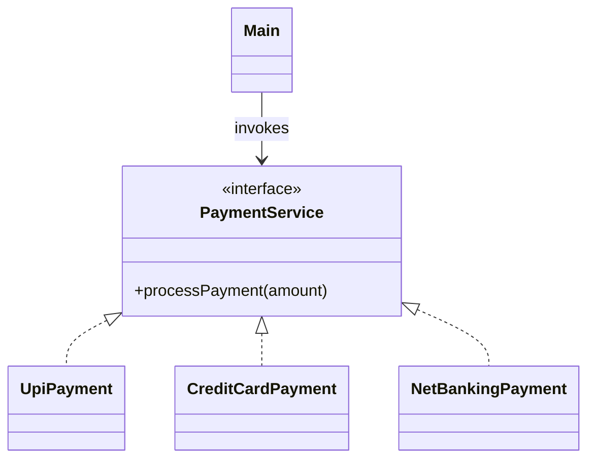

**Read it:** Compare the shared contract with each implementation and the calls in `Main.java`. Adding a new payment implementation can avoid changing existing implementations; the code that selects/constructs it still needs a decision.

**Takeaway:** Keep stable behavior open to extension through abstractions, rather than repeatedly editing a central conditional.

### 3. Liskov Substitution Principle (LSP)

**Code:** [src/solid/lsp](src/solid/lsp)

The example distinguishes payments that support refunds from payments that do not. Refund-capable payment types implement `Payment`; crypto payment is represented separately by `NonRefundablePayment`. `PaymentClient` has corresponding processing paths.

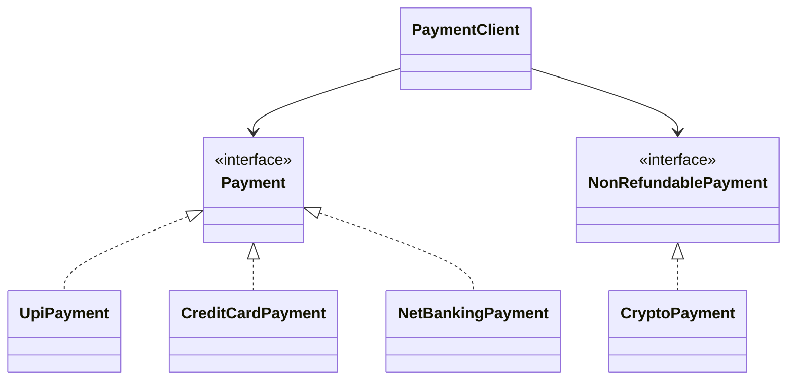

**Read it:** Inspect the payment contracts and `PaymentClient`. The important modeling decision is not to promise refund behavior for a payment type that cannot honor it.

**Takeaway:** A subtype must preserve the expectations of the abstraction it implements. Do not add unsupported behavior or surprise callers with stronger preconditions.

### 4. Interface Segregation Principle (ISP)

**Code:** [src/solid/isp](src/solid/isp)

The example uses small role-based interfaces such as `Coder`, `Tester`, and `Deployer`. Backend, QA, and DevOps roles implement the capabilities they need.

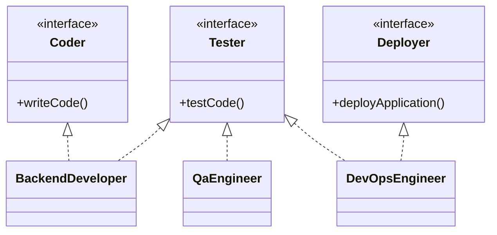

**Read it:** Compare the interfaces with the three role classes and their usage in `Main.java`.

**Takeaway:** Clients should depend only on the capabilities they use; avoid forcing every role to implement irrelevant methods.

### 5. Dependency Inversion Principle (DIP)

**Code:** [src/solid/dip](src/solid/dip)

`UserService` receives a `Database` abstraction through its constructor. `MySqlDatabase` and `MongoDatabase` implement that contract; the caller chooses which implementation to provide.

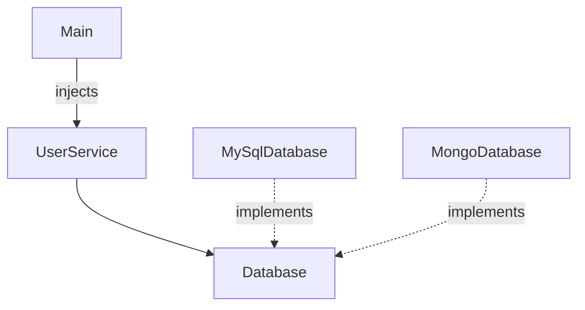

**Read it:** Follow the constructor call in `Main.java`, then inspect `UserService` and the database implementations.

**Takeaway:** High-level policy depends on an abstraction, not a specific database. Constructor injection makes the dependency visible and easier to replace in tests.

## Design patterns

### 1. Factory

**Code:** [src/factory](src/factory)

**Problem:** The caller needs a notification, but should not construct the concrete notification class itself.

**Roles:** `Notification` is the product contract; `EmailNotification` and `SMSNotification` are products; `NotificationFactory` contains the creation decision; services use the resulting notification.

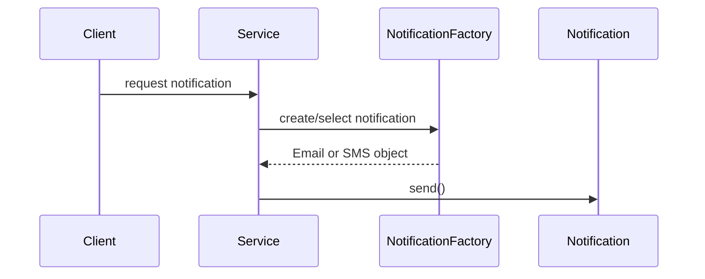

**Read it:** Follow `Main.java` → `OrderService`/`DeliveryService` → `NotificationFactory` → concrete notification. Inspect `sendAllNotification()` as a separate path.

**Trade-off:** Centralizes creation, but the factory's selection logic may grow as types are added.

### 2. Abstract Factory

**Code:** [src/absFactory](src/absFactory)

**Problem:** Create related notification components as a family—for example, an email notification with its email template, or an SMS notification with its SMS template.

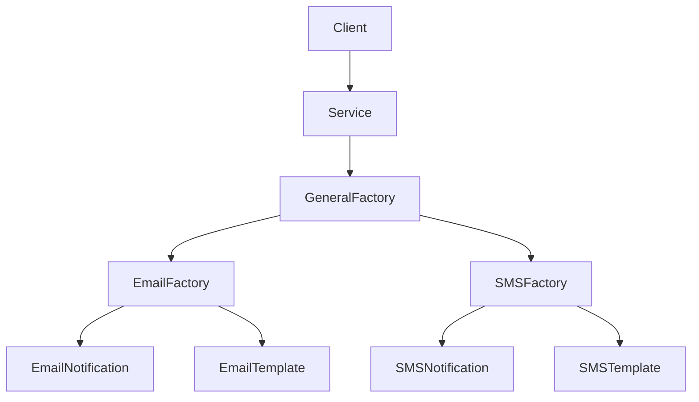

**Read it:** Start at `Main.java`, then trace `OrderService`/`DeliveryService`, `GeneralFactory`, and the concrete factories. Follow the returned notification and template types.

**Factory vs Abstract Factory:** Factory commonly creates one product; Abstract Factory creates a compatible family of related products. The example's family is notification + template.

**Trade-off:** Adding a new family is straightforward, but adding a new product type to every family can require changing the factory contract and all concrete factories.

### 3. Adapter

**Code:** [src/adapter](src/adapter)

**Problem:** Payment providers expose different APIs, while the client expects one `PaymentService` interface.

```mermaid
flowchart LR
    Client --> PaymentClient
    PaymentClient --> PaymentService
    PaymentService <|.. PaypalAdapter
    PaymentService <|.. RazorpayAdapter
    PaypalAdapter --> PaypalGateway
    RazorpayAdapter --> RazorpayGateway
```

**Read it:** `Main.java` constructs each adapter around its provider gateway, then passes the adapter to `PaymentClient`. Inspect how the adapter translates the common call into the provider-specific call.

**Trade-off:** Keeps provider-specific details out of the client, but each provider may need its own adapter and mapping logic.

### 4. Builder

**Code:** [src/builder](src/builder)

**Problem:** Construct an object with multiple fields without an unwieldy constructor or exposing a half-configured object.

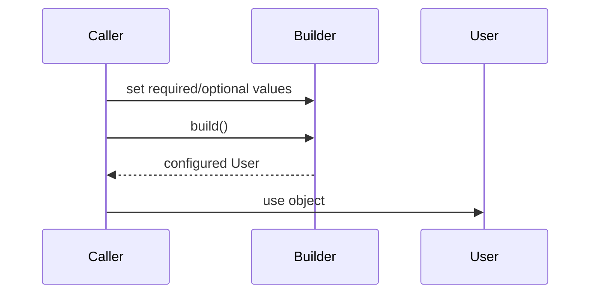

**Read it:** Inspect `User.java` for the builder API and object construction. Then compare how `LoginService`, `EmailService`, and `UserMigrationService` use it.

**Trade-off:** Improves readability for complex construction, but adds code and is unnecessary for objects with only a few simple fields.

### 5. Chain of Responsibility

**Code:** [src/chainOfResponsibility](src/chainOfResponsibility)

**Problem:** Route an issue through support levels until a handler can handle it, without making the client know every handler.


**Read it:** `Main.java` wires the chain in order and submits a `LEVEL3` issue. Inspect the handler contract, each handler's decision, and how it delegates to its successor.

**Trade-off:** The chain is flexible and decouples the sender, but an issue can reach the end unhandled; chain order and termination must be clear.

### 6. Decorator

**Code:** [src/decorator](src/decorator)

**Problem:** Add optional behavior or cost to a pizza without creating a subclass for every topping combination.

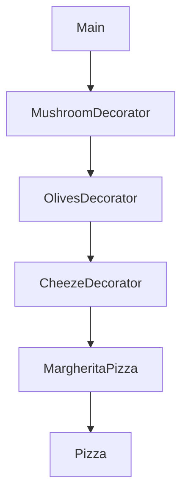

**Read it:** Follow the wrapping sequence in `Main.java`. Each decorator holds a `Pizza`, delegates to it, and adds its own description/cost. The final object is a stack of wrappers.

**Trade-off:** Toppings can be composed at runtime, but deeply nested wrappers can make debugging and object inspection harder.

### 7. Observer

**Code:** [src/observer](src/observer)

**Problem:** Notify multiple subscribers when a channel publishes a video, without the channel hard-coding each subscriber.

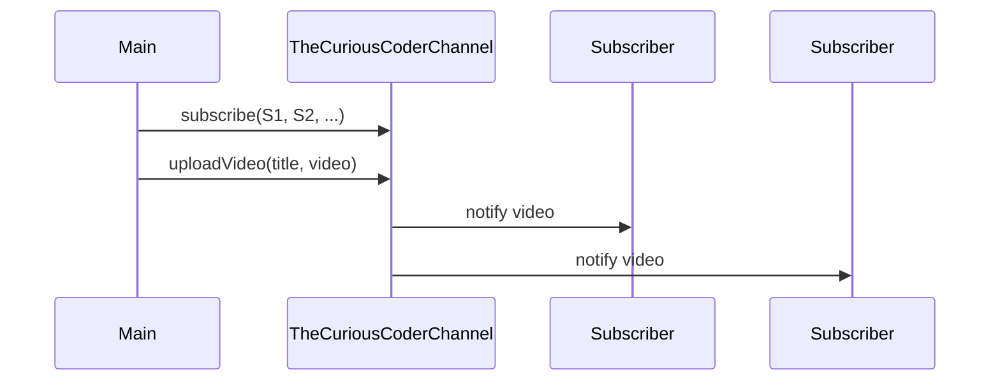

**Read it:** Inspect `TheCuriousCoderChannel`'s subscriber collection, subscribe operation, and upload/notification flow. Then read `YoutubeSubscriber` to see the receiver behavior.

**Trade-off:** Publisher and subscribers are loosely coupled, but subscription lifecycle, duplicate subscriptions, and notification failures need policy.

### 8. Prototype

**Code:** [src/prototype](src/prototype)

**Problem:** Create several similar game characters by copying a configured prototype instead of repeating the full setup.

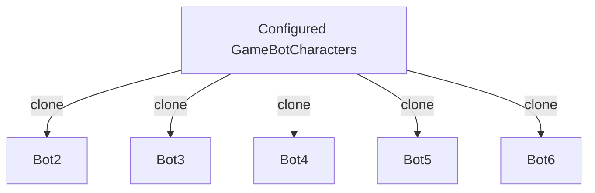

**Read it:** `Main.java` creates one character and clones it several times, then changes names and mutates one weapons list. Inspect `GameBotCharacters.clone()` closely.

**Important:** The example uses a mutable `List<String>`. Verify whether cloning copies that list or shares it. A shallow copy can cause one clone's list mutation to affect another; use a defensive/deep copy when independent state is required.

### 9. Proxy

**Code:** [src/proxy](src/proxy)

A proxy stands in front of a subject and controls or mediates access. This repository demonstrates three variants:

| Variant | Example | Intent |
|---|---|---|
| Protection | `src/proxy/protectionProxy/` | Check access before delegating |
| Remote | `src/proxy/remoteproxy/` | Represent a service across a boundary |
| Virtual | `src/proxy/virtualProxy/` | Delay expensive work until needed |

**Protection proxy flow**

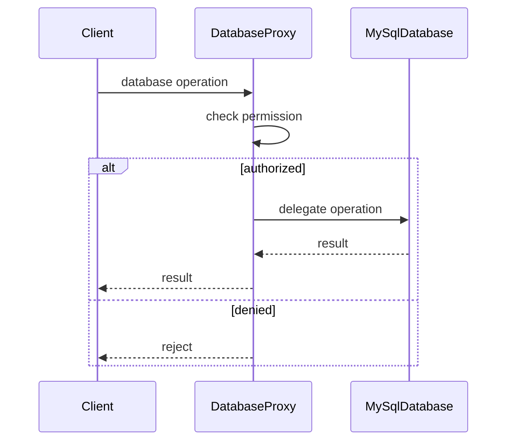

**Virtual proxy flow:** the client calls `MovieProxy`; the proxy can defer creation/loading of the real `Movie`/video until the operation needs it. **Remote proxy:** inspect the local and remote server packages to see how the local-facing object represents the remote weather service.

**Trade-off:** Proxies add a useful control point, but can introduce indirection, latency, or hidden work.

### 10. Singleton

**Code:** [src/singleton](src/singleton)

**Problem:** Ensure callers obtain the same shared instance.

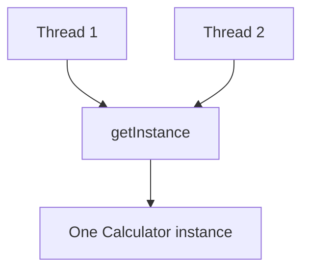

**Read it:** Inspect `Calculator.java` for the instance field, constructor visibility, and `getInstance()`; `Main.java` calls it from two threads.

**Trade-off:** Convenient shared access, but global state makes tests and dependencies harder to reason about. Verify thread safety and safe publication; a singleton is not automatically thread-safe.

### 11. Strategy

**Code:** [src/strategy](src/strategy)

**Problem:** Choose encryption and compression behavior independently of the notification type.

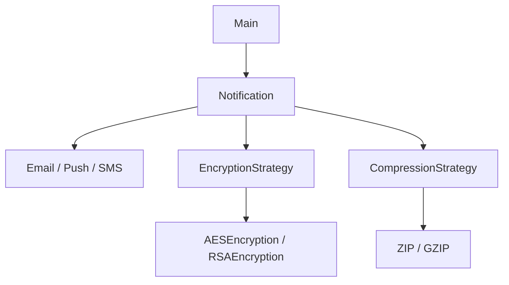

**Read it:** `Main.java` injects encryption and compression strategies into each notification. Inspect `Notification.java` to see how it delegates, then compare the strategy implementations.

**Trade-off:** Algorithms are interchangeable and independently testable, but the caller must select compatible strategies and the number of types can grow.

## Run examples

### Requirements

- JDK 8 or later for language basics; some examples may use newer Java syntax.
- IntelliJ IDEA, Eclipse, or a terminal with `javac`.

Clone:

```bash
git clone https://github.com/subhadip199/LLD.git
cd LLD
git switch master
```

For a package with a `Main` class, compile its Java files from the repository root and run using the package name. For example:

```bash
javac src/strategy/*.java
java -cp src strategy.Main
```

Some examples use a no-argument `main()` method rather than the traditional `public static void main(String[] args)`; those require a Java runtime/IDE that supports that entry point, or the method should be changed to the standard signature for a conventional command-line launch.

## Interview practice

For each topic, practice answering:

1. What problem does this design solve?
2. What are the roles of the classes/interfaces?
3. Walk through one request from the entry point.
4. What changes when a new implementation is introduced?
5. What are the trade-offs or failure cases?
6. How would you test the design?

## Contributing

Keep examples focused, readable, and runnable. Include a small demonstration and explain the design decision and trade-offs.

## License

No license is currently specified.
